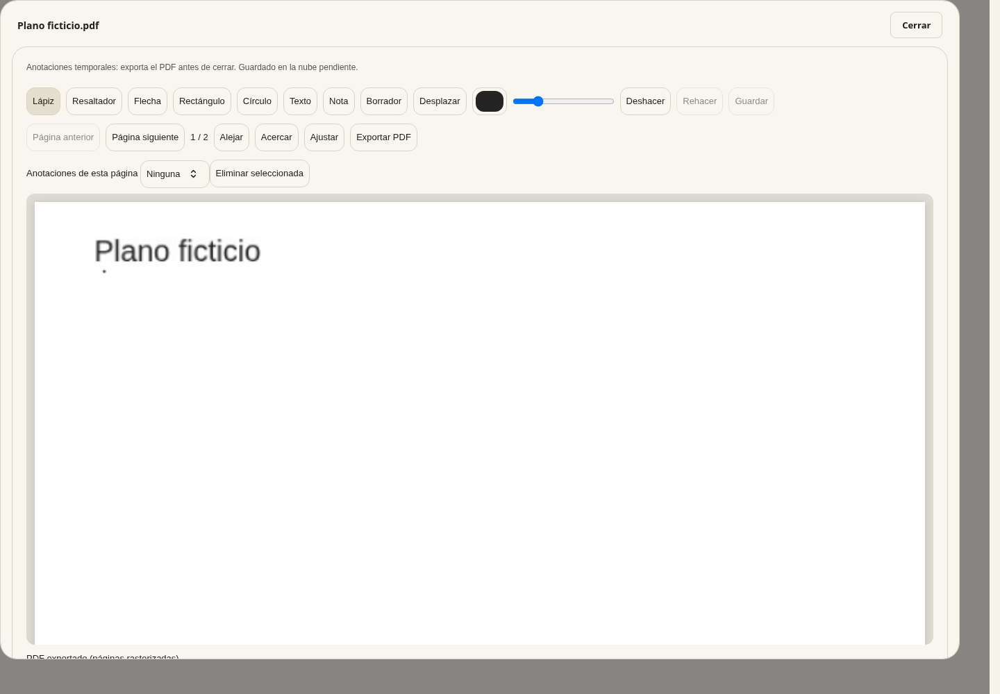
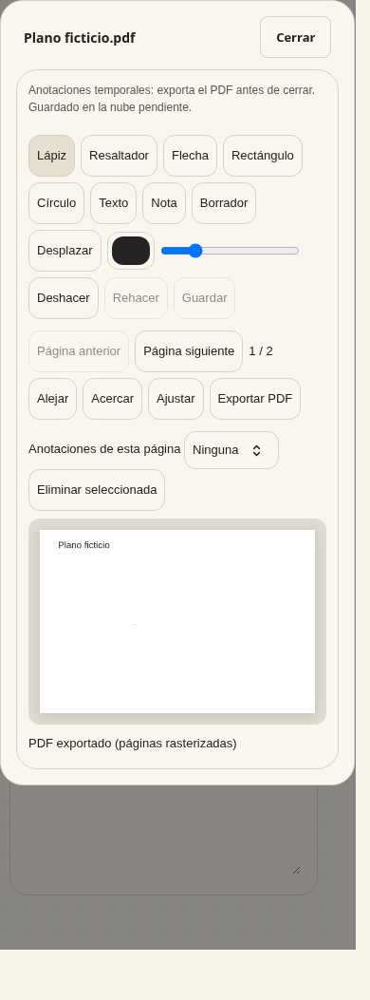

# Documentos y Planos — entrega parcial v3.65.17

Encargo [#24](https://github.com/estudiomoderno/moderno.app/issues/24), actualizado el 11/10/2026 para permitir publicar la interfaz independiente, sin activar una persistencia no validada. Destino: `app.moderno.app`. No se cierra #24 con esta entrega.

## Comportamiento implementado

La pestaña «Archivos y notas» pasa a llamarse **Documentos**; conserva su clave/ruta `archivos`. «Compras» se etiqueta **Listas de compra**. Documentos contiene Planos y Archivos; Referencias/Revisiones se muestran deshabilitados como pendientes. Las notas siguen disponibles y se conservan adjuntos, índices, identificadores, visibilidad de cliente, descargas y subida existente.

Planos filtra PDF, PNG, JPEG y WebP ya adjuntos al proyecto. «Ver y anotar» resuelve la referencia mediante `fileResolveForView`, que ya comprueba pertenencia y obtiene una URL firmada. No se persisten URLs firmadas. «Ver original» conserva el visor anterior. Los archivos sin contenido o todavía subiendo no habilitan el editor.

El editor paginado ofrece zoom, desplazamiento, lápiz, resaltador, flecha, rectángulo, círculo, texto, nota, color/grosor, borrador de anotaciones completas, selector de anotaciones, deshacer/rehacer y exportación PDF multipágina. El original permanece inalterado. La exportación de PDF conserva dimensiones y orientación de página pero **rasteriza** su contenido; no conserva texto seleccionable ni vectores. Para imágenes se genera PDF a partir del bitmap.

**Las anotaciones son temporales, solo en memoria. Guardar en la nube está deshabilitado y se informa expresamente antes de dibujar.** Exportar descarga un PDF; no equivale a guardar anotaciones en el estudio. Cerrar un borrador requiere confirmación; salir de sesión o cambiar identidad invalida y cierra el visor. No hay localStorage alternativo ni sincronización simulada.

## Seguridad y bloqueo de persistencia

No se añade ningún RPC, tabla, política, usuario, bucket ni escritura Storage. El módulo de integración no modifica el proyecto ni llama a guardado. Reutiliza la lectura existente de archivos y verifica rol/identidad/proyecto tras las operaciones asíncronas. Estas comprobaciones cliente no reemplazan los permisos actuales del servidor y no acreditan permisos para un nuevo guardado.

`moderno-pruebas` (`chsilowzrtumbcofspwv`) continúa activo pero sin tablas `public`. El runtime sigue apuntando a `auth.moderno.app` y la política de red no permite el dominio de pruebas. Se mantiene el bloqueo [#3](https://github.com/estudiomoderno/moderno.app/issues/3) para inicialización, persistencia y comprobaciones backend con identidades ficticias. No se utilizaron usuarios, sesiones, archivos ni registros reales para las pruebas.

El código anterior aislado del PR #29 se reutiliza en esta entrega explícitamente limitada y activada en Documentos; #29 sigue en borrador y su informe original es histórico. No se han completado la recuperación de anotaciones tras recarga/logout ni los permisos backend de anotaciones. Antes de activar ese guardado: pruebas ficticias aisladas, esquema/contrato de versión, control de concurrencia, permisos negativos entre estudios, recuperación, reversión y autorización específica para cambios sensibles productivos si fueran necesarios.

## Archivos y validación

- `app/index.html`, `app/project-ui.js`: carga de módulos, navegación y conservación de notas/adjuntos.
- `app/project-documents.js`: filtro, descarga acotada y diálogo protegido, sin escrituras.
- `app/plan-annotations.js`, `app/plan-editor.js`, `app/plan-editor.css`: modelo en memoria, visor, herramientas y exportador; PDF.js existente se carga bajo demanda con evaluación deshabilitada.
- `scripts/plan-annotations.test.mjs`, `scripts/project-documents.test.mjs`: modelo, límites, HTML seguro y contrato de integración sin guardado.
- `.github/workflows/deploy-app.yml`, `scripts/verify-app-publication.mjs` y su test: comprobación posterior al despliegue por hash del HTML y cinco módulos/estilos públicos, con destino fijo, sin sesión ni datos privados.
- `scripts/plan-editor-browser.test.py`: ensayo reproducible offline con Chromium/Playwright y PDF.js 3.11.174 local, la versión existente de la app.

**422 tests Node aprobados**, incluyendo 14 nuevos. La persistencia del modelo se ensaya con adaptador ficticio y NO demuestra guardado/backend real. La suite incluye comprobaciones existentes de archivos privados; tampoco se presenta como una nueva prueba backend de anotaciones.

Ensayo Chromium del visor a 1280/390px: PDF ficticio de dos páginas, todas las herramientas, borrado, zoom/undo/redo, texto literal seguro, exportación reabierta por PDF.js con mismo número y tamaño de páginas, original intacto y cierre protegido. PNG generado, PDF con rotación de 90° y errores de formato/tamaño verificados. Ensayo de la pantalla real de proyecto con estado ficticio y red interceptada a 1440/390px: navegación, adjuntos/notas anteriores, visor, exportación, cierre cancelado, logout/rol denegado y proyecto sin cambios. Capturas exclusivamente ficticias:




Reproducción del visor:

```sh
node --test scripts/*.test.mjs
npm pack pdfjs-dist@3.11.174 --ignore-scripts --pack-destination /ruta/scratch
# Extraer package/build/pdf.min.js y pdf.worker.min.js del tar en scratch.
python3 scripts/plan-editor-browser.test.py /ruta/scratch/package/build
```

Los checks oficiales del PR/deploy ejecutan también sintaxis PHP y autorización de invitaciones sin enviar correos. El resultado de publicación se registra en el PR y #24 tras comprobar Actions y los recursos públicos; una prueba local no demuestra publicación.

## Límites y reversión

Archivos hasta 50 MB/100 páginas; máximo 20 megapíxeles por página o imagen; exportación hasta 100 megapíxeles/100 MB. Las descargas externas requieren CORS; ante un fallo se conserva el acceso al visor original. No se certifican lápiz físico, Safari, iPad, Android, accesibilidad completa para dibujar sin puntero, realtime, historial de revisiones ni guardado recuperable.

Revertir el commit de esta entrega devuelve navegación/HTML anteriores; los módulos pueden retirarse después de dejar de cargarlos. No hay cambios de datos, esquema ni Storage que revertir. No forzar recargas ni descartar borradores de sesiones ya abiertas. Mantener #24 abierto hasta completar su aceptación.
