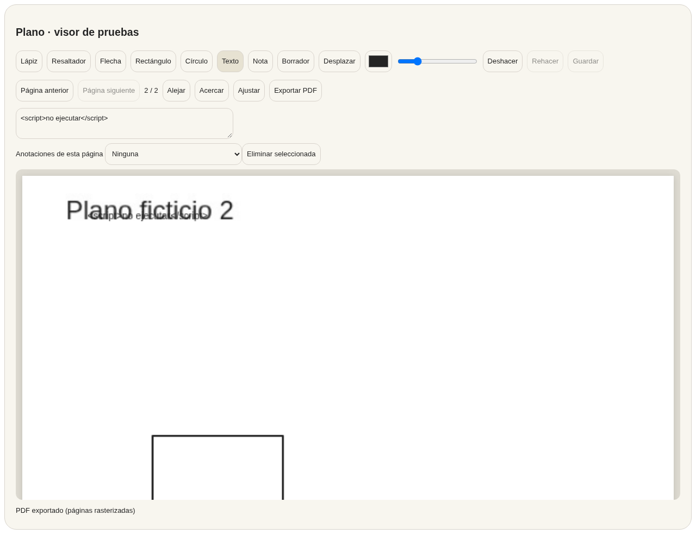

# Planos — fase 1 en curso, entorno integrado bloqueado

Fecha: 11/10/2026. Encargo [#23](https://github.com/estudiomoderno/moderno.app/issues/23), primera entrega [#24](https://github.com/estudiomoderno/moderno.app/issues/24). Rama `planos/fase1-visor-20261011`, base `c7b62fa`.

**Entrega parcial en borrador. No satisface todavía la aceptación de fase 1. No fusionar ni desplegar.** Se utiliza la excepción explícita de #24: adelantar visor/editor autocontenidos cuando faltan esquema, RLS y Storage de pruebas. Las fases 2 y 3 siguen pendientes, en ese orden.

## Verificación del entorno y bloqueo #3

- Repositorio `estudiomoderno/moderno.app`, rama independiente; sin modificaciones anteriores al encargo.
- Proyecto verificado por el conector Supabase: `moderno-pruebas`, ref `chsilowzrtumbcofspwv`, activo, región eu-west-1.
- Consultas de solo lectura: ninguna tabla en `public`; 0 usuarios Auth, 0 buckets y 0 objetos Storage. No es una réplica utilizable de la aplicación.
- El entorno Cloud sigue configurado con `SUPABASE_URL` cuyo host es `auth.moderno.app`, asociado a producción. No se inició la app con esa configuración ni se utilizó su clave para pruebas.
- La política de red solo permite el preset de gestores de paquetes; no incluye `chsilowzrtumbcofspwv.supabase.co`. La petición HTTPS al backend de pruebas devuelve bloqueo 403 del proxy.
- Falta configurar privadamente la URL y clave publicable del MISMO proyecto de pruebas, permitir HTTPS/WSS al dominio anterior y verificar el arranque aislado. No introducir claves en GitHub ni en el chat.
- No se aplicaron migraciones, no se crearon usuarios y no se escribieron datos en ninguno de los proyectos Supabase.

## Inventario inicial para inicializar pruebas

No basta con crear una tabla de anotaciones: la app necesita sus contratos actuales. Este inventario es inicial, no una declaración de que todos los SQL puedan ejecutarse directamente sobre una BD vacía.

| Contrato | Referencias vigentes | Requisito de pruebas |
| --- | --- | --- |
| Identidad y pertenencia al estudio | `app/index.html`: RPC `unirse_al_estudio`, `app_rol`; tablas `estudios`, `miembros`, `invitaciones` | Base versionada con claves/FK, usuarios ficticios y pertenencias de dos estudios; verificar denegación sin pertenencia |
| Bloques del proyecto e historial | `datos_estudio`, `datos_estudio_hist`; `SQL/guardar-bloque-versionado.sql`, `SQL/flujos-trabajo.sql` | Revisar esquema base y dependencias; guardado con control de versión, errores y conflictos reales |
| Lectura/escritura por rol | `SQL/permisos-roles.sql`, `SQL/permisos-colaboradores.sql`, `SQL/portales-filtrados.sql` | RLS y RPC con autorización de servidor; pruebas administrador/colaborador/gestoría y acceso entre estudios |
| Archivos privados | `app/private-files.js`, `fileResolveForView` en `app/index.html`, `SQL/permisos-archivos.sql` | Bucket privado `archivos`, rutas por estudio, registro y permisos; URL firmada no equivale a autorización persistente |
| Anotaciones nuevas | Módulos aislados de este PR, sin integración todavía | Diseñar migración por estudio/proyecto/archivo/revisión, autor, páginas y versión de guardado; permisos de servidor antes de activar escritura |

Propuesta de inicialización: completar la base versionada a partir de contratos vigentes (los esquemas mínimos de tests no son una instalación completa); ordenar sus dependencias; ensayar exclusivamente en `moderno-pruebas`; crear dos estudios e identidades ficticias; verificar Auth/RLS/RPC/Storage, revocación y guardado con recarga. Solo entonces integrar Planos. No copiar backups, usuarios, correos ni archivos reales. Reversión de pruebas: retirar únicamente objetos y registros ficticios identificados del ensayo; ningún SQL destructivo productivo.

## Implementación aislada

- `app/plan-annotations.js`: modelo separado del original, coordenadas normalizadas por página, validación, referencias estables, deshacer/rehacer, borrador y guardado mediante adaptador explícito con revisión base. La comprobación cliente no sustituye RLS.
- `app/plan-editor.js`: PDF e imágenes PNG/JPEG/WebP, paginación, zoom/desplazamiento, lápiz/resaltador/flecha/rectángulo/círculo/texto/nota, color/grosor, eliminación y exportación PDF multipágina rasterizado. Reutiliza PDF.js suministrado por el llamante, sin añadir librerías al producto. `isEvalSupported:false`.
- `app/plan-editor.css`: estilos acotados con la paleta crema actual, adaptación de anchura y controles etiquetados.
- `scripts/plan-annotations.test.mjs`: 8 pruebas del modelo/exportador.
- `scripts/plan-editor-browser.test.py`: demostración repetible en Chromium con PDF ficticio generado, red interceptada y ninguna sesión Supabase.
- `docs/PLANOS-FASE1-DEMO.png`: captura de ese ensayo aislado, no de la app integrada.

Los módulos **no se cargan desde `app/index.html`**. Se conservan archivos, notas, navegación y datos actuales. El cambio de nombre a Documentos, las subsecciones y la apertura de archivos autorizados se integrarán al completar el entorno. No hay controles de guardado ficticio: sin adaptador, Guardar permanece deshabilitado y se informa del bloqueo; exportar no borra la condición de borrador.

## Comprobaciones ejecutadas

```sh
node --test scripts/*.test.mjs
# 416 pruebas aprobadas, 0 fallos; incluye 8 nuevas.

# Instalar solo en scratch la versión PDF.js que ya utiliza la app:
npm pack pdfjs-dist@3.11.174 --ignore-scripts --pack-destination /ruta/scratch
# Extraer package/build/pdf.min.js y pdf.worker.min.js del tar.
python3 scripts/plan-editor-browser.test.py /ruta/scratch/package/build
# PASS Chromium 1280px y 390px, sin peticiones a Supabase.
```

El navegador verifica PDF real de dos páginas, trazos y páginas, coordenadas tras zoom, undo/redo, texto literal que contiene etiquetas, guardado deshabilitado, exportación leída de nuevo por PDF.js con dos páginas, bytes originales intactos y protección al cerrar con borrador. La prueba de persistencia del modelo utiliza un adaptador ficticio: **no demuestra persistencia ni aislamiento backend**.

PHP no está instalado en este entorno; `php -l mailer/enviar-invitacion.php` y `php scripts/invitation-auth.test.php` quedan para los checks existentes de GitHub Actions. No se modificó mailer.



## Pendiente, límites y reversión

- No probado todavía: autenticación y reapertura tras logout/recarga contra Supabase, persistencia integrada, permisos negativos entre estudios, Storage real, errores de red integrada, PDF rotado y documentos grandes, Safari/iPad/Android ni lápiz físico.
- Límite inicial: archivos de 50 MB, 100 páginas, 20 megapíxeles por página/imagen; exportación de 100 megapíxeles/100 MB. Exportación rasterizada: no conserva texto seleccionable/vectorial ni dimensiones físicas del original. Revisar fidelidad/tamaño antes de aceptación.
- Borrador: eliminación por proximidad a puntos y selector; no hay selección geométrica avanzada ni borrado parcial de trazos. Interfaz y pruebas de todas las herramientas aún requieren ampliación.
- No hay realtime, aprobación de versiones, tareas/compras enlazadas ni sincronización offline. No se anuncian estas funciones.
- Reversión: eliminar los archivos nuevos de esta entrega (no activados), o revertir su commit. No hay migraciones ni datos que revertir. No fusionar este borrador mientras persista #3 y no se cumpla #24.

Para avanzar #25 y después #26 se exige previamente evidencia de aceptación de #24. No se cierran los issues con esta entrega parcial.
